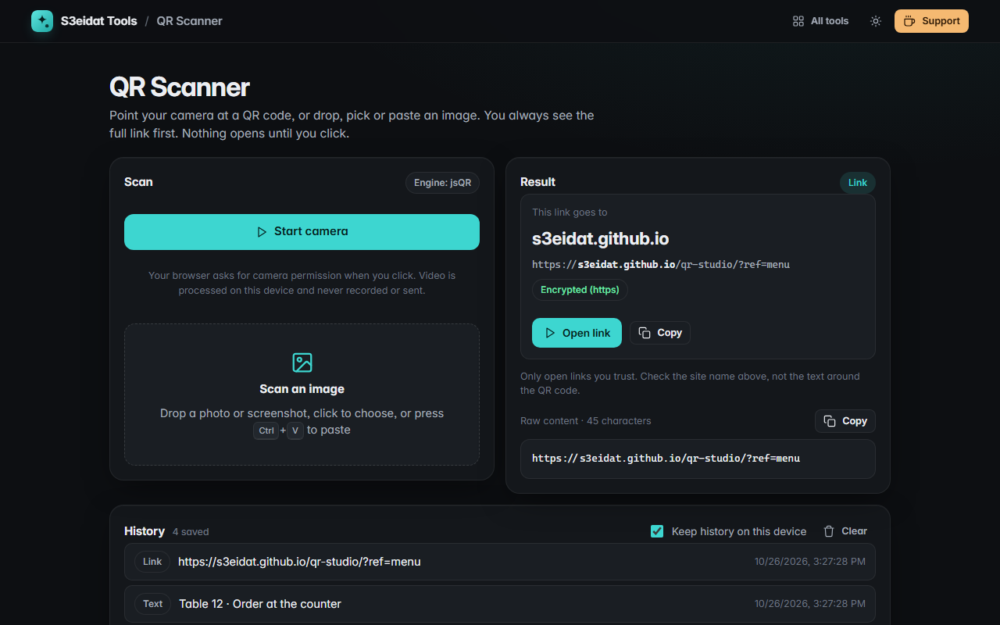

# QR Scanner

> Scan QR codes with your camera or from an image. Free, private, and it runs entirely in your browser.

### ▶ [Open QR Scanner](https://s3eidat.github.io/qr-scanner/)



## Features

- **Camera scanning** with the back camera on phones, a camera switcher, and a torch toggle when your device supports it
- **Scan an image**: drop, choose or paste (Ctrl+V) a photo or screenshot; light-on-dark codes work too
- Uses the browser's built-in **BarcodeDetector** when available, otherwise **jsQR**
- **Links are never opened automatically.** You see the real site name and the full address first, plus warnings for
  `http`, lookalike (punycode) domains, `user@host` tricks, bare IP addresses and unusual ports. Non-web schemes can't be opened at all
- Understands **Wi-Fi** (network, password, security), **contacts** (vCard and MeCard, save as `.vcf`), **email**, **SMS**,
  **phone**, **location** and **calendar events**, with a copy button on every field
- **History** of your last 50 scans, kept only in this browser; switch it off or clear it any time

## Privacy

The camera only starts when you click **Start camera**, and it stops when you leave the tab. Video frames and images are
decoded on your device and never recorded or uploaded. There is no server, no account, no analytics. The page ships with a
strict Content-Security-Policy (`connect-src 'self'`), so the browser itself blocks any attempt to send data anywhere.

## Run it yourself

It's plain HTML, CSS and JavaScript with no build step:

```bash
git clone https://github.com/s3eidat/qr-scanner
cd qr-scanner
python -m http.server 8000
```

Then open http://localhost:8000. (The camera needs `localhost` or https.)

## Credits

QR decoding fallback by [jsQR](https://github.com/cozmo/jsQR) (Cosmo Wolfe, Apache-2.0), shipped in `lib/`.

## Support

If this saved you time, **[buy me a coffee ☕](https://s3eidat.github.io/coffee/)**. It keeps every tool free.

---

Part of **[S3eidat Tools](https://s3eidat.github.io/)**: 100+ free, private tools that run in your browser. MIT licensed.
